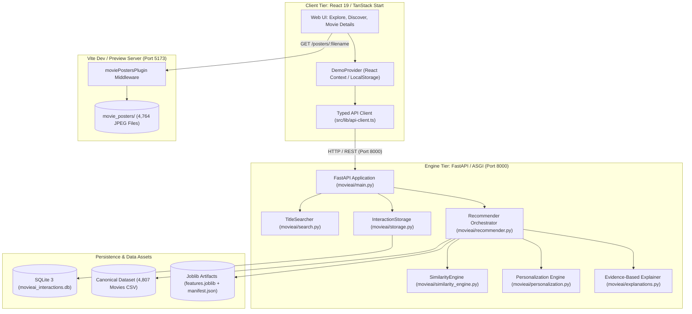
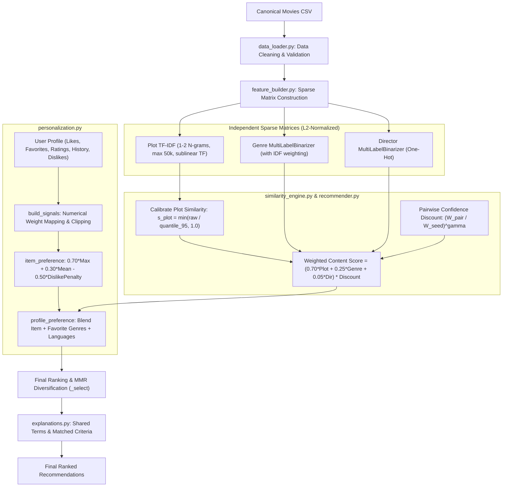
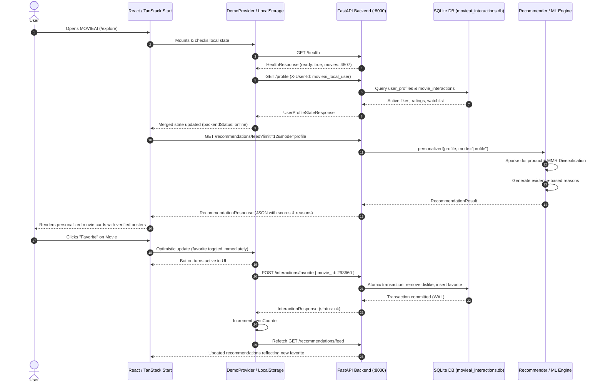
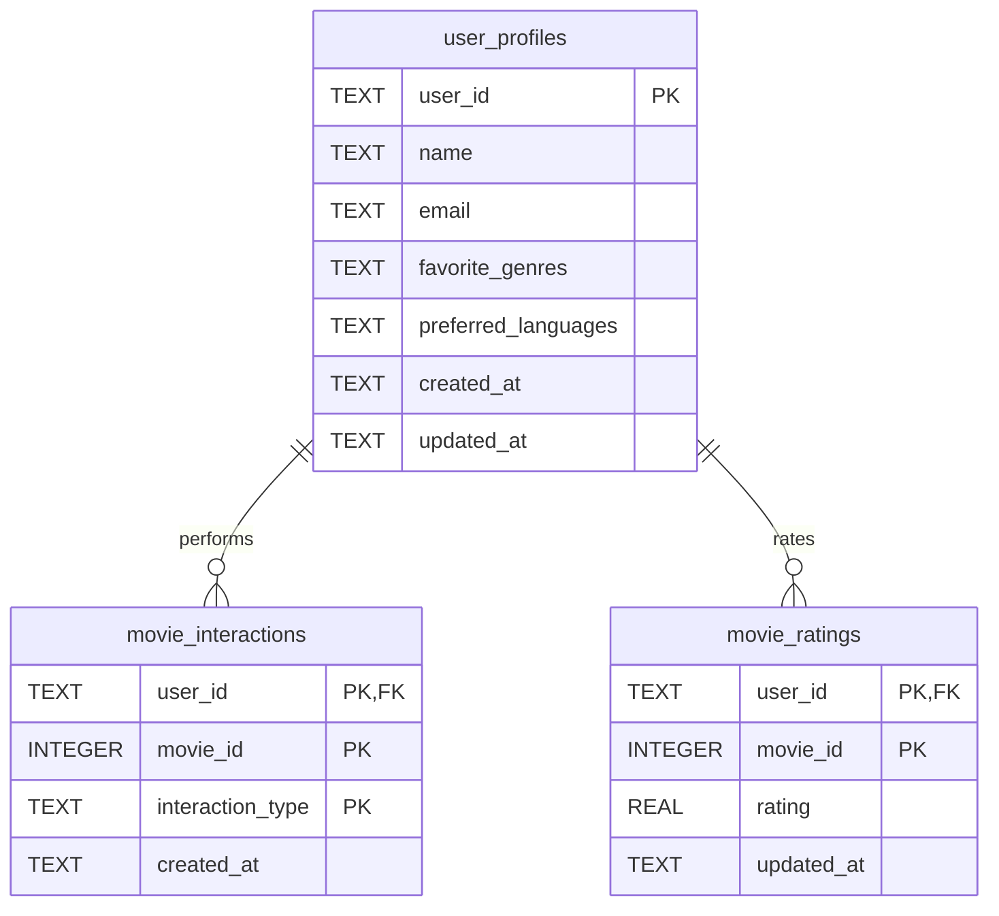

# MOVIEAI — Personalized Cinematic Movie Discovery

> **A high-performance, content-based movie discovery platform pairing a dark cinematic TanStack Start (React 19) frontend with an evidence-based Python / FastAPI recommendation engine.**

---

## Table of Contents

1. [Project Overview](#1-project-overview)
2. [Feature Matrix & Implementation Status](#2-feature-matrix--implementation-status)
3. [Technology Stack](#3-technology-stack)
4. [System Architecture](#4-system-architecture)
5. [Repository & Directory Structure](#5-repository--directory-structure)
6. [Recommendation Engine — In-Depth Algorithm Breakdown](#6-recommendation-engine--in-depth-algorithm-breakdown)
7. [End-to-End Data Flow](#7-end-to-end-data-flow)
8. [API Reference](#8-api-reference)
9. [Data Model & SQLite Persistence](#9-data-model--sqlite-persistence)
10. [Movie Dataset & Poster Pipeline](#10-movie-dataset--poster-pipeline)
11. [Installation & Local Setup on Windows](#11-installation--local-setup-on-windows)
12. [Testing & Verification](#12-testing--verification)
13. [Example User Journey](#13-example-user-journey)
14. [Security, Limitations & Production Readiness](#14-security-limitations--production-readiness)
15. [Future Improvements](#15-future-improvements)
16. [Glossary](#16-glossary)

---

## 1. Project Overview

### What is MOVIEAI?
**MOVIEAI** is an intelligent, full-stack movie discovery platform designed to eliminate "streaming fatigue" and decision paralysis. Instead of presenting an infinite grid of unranked titles or relying on generic popularity, MOVIEAI analyzes cinematic DNA—synopsis semantics, sub-genres, and directorial style—to deliver transparent, explainable recommendations that adapt in real time to viewer interactions.

### The Problem It Solves
Traditional video streaming platforms suffer from several core flaws:
* **Catalog Saturation:** Users spend an average of 18 minutes searching for something to watch before abandoning the session or picking a familiar re-run.
* **Black-Box Suggestions:** Common recommendation systems offer opaque carousels ("Because you watched *Inception*") without explaining *why* a film was selected.
* **Streaming vs. Discovery Confusion:** Commercial streaming apps prioritize content based on licensing agreements and internal promotional targets rather than genuine viewer taste compatibility.

### Discovery vs. Streaming
MOVIEAI is explicitly a **movie discovery and taste-alignment system**, not a media streaming host:
* It does **not** host, license, or stream copyrighted full-length video media files.
* It indexes canonical film metadata (plots, directors, release metrics, verified local artwork, audience reception).
* It computes taste affinity scores, visualizes vibe meters, and explains matching criteria so users can discover what to watch next on their streaming platform of choice.

### Project Summary (Repository / Resume)
> **MOVIEAI**: Production-style movie discovery engine integrating a **TanStack Start / React 19** SSR frontend with an asynchronous **Python / FastAPI** content recommendation engine. Features a calibrated multi-signal vector space model combining **sublinear TF-IDF (1–2 grams)**, **IDF-weighted multi-label genre vectors**, and **one-hot director matrices** with pairwise confidence discounting and Maximal Marginal Relevance (MMR) diversification. Powered by an ACID-compliant SQLite WAL interaction store and local serving of 4,700+ high-resolution film posters.

---

## 2. Feature Matrix & Implementation Status

To provide complete transparency, features across both the frontend and backend are classified into four strict verification tiers:

| Feature | Description | Implementation Status | Code Reference |
| :--- | :--- | :--- | :--- |
| **Searchable Movie Catalogue** | Multi-tier title resolver (exact, normalized, prefix, word tokens, fuzzy) with year disambiguation | **Implemented & Verified** | `movieai/search.py`, `src/lib/api-client.ts` |
| **Multi-Signal Content Engine** | Calibrated TF-IDF synopsis similarity (70%), genre IDF (25%), director matching (5%) | **Implemented & Verified** | `movieai/similarity_engine.py`, `movieai/feature_builder.py` |
| **Personalized Taste Scoring** | Vectorized combination of likes (+1.0), favorites (+1.5), ratings ([-1, 1]), watch history (+0.1), watchlist (+0.2), and dislikes (-1.5) | **Implemented & Verified** | `movieai/personalization.py` |
| **Evidence-Based Explanations** | Explanations generated directly from sparse dot-product shared terms, matching genres, and directors | **Implemented & Verified** | `movieai/explanations.py` |
| **MMR Diversification** | Maximal Marginal Relevance reranking to eliminate monochromatic recommendations | **Implemented & Verified** | `movieai/recommender.py` (`_select`) |
| **SQLite Interaction Store** | SQLite persistence with WAL mode, foreign keys, and atomic state toggles | **Implemented & Verified** | `movieai/storage.py` |
| **Local Poster Server** | Zero-copy high-performance streaming of 4,764 posters via custom Vite dev/preview middleware | **Implemented & Verified** | `vite.config.ts` (`moviePostersPlugin`) |
| **Optimistic Frontend State** | Global React Context with instant UI updates, offline fallback, and automated SQLite synchronization | **Implemented & Verified** | `src/components/movieai/demo-context.tsx` |
| **Explore Catalogue & Preferences** | Searchable 4,800+ movie catalogue with filters, sorting, genre browsing, and active user preference collection (likes, dislikes, ratings, favorites, watchlist) | **Implemented & Verified** | `src/components/movieai/explore-page.tsx` |
| **For You Personalized Feed** | Dedicated recommendation dashboard featuring horizontally scrollable genre-wise rows, match percentages, and evidence-based explanations | **Implemented & Verified** | `src/components/movieai/for-you-page.tsx`, `src/routes/discover.tsx`, `src/routes/for-you.tsx` |
| **Audience Vibe & Movie Meter** | 4-choice audience reception meter (Skip, Timepass, Go For It, Perfection) and dynamic vibe radar | **Implemented & Verified** | `src/components/movieai/movie-details/movie-meter.tsx` |
| **Interactive WebGL Effects** | GPU-accelerated canvas animations (`ShapeWaves`, `Aurora`, `ColorBends`) powered by OGL | **Implemented but Not Manually Verified** | `src/components/ShapeWaves.tsx`, `ColorBends.tsx` |
| **Multi-Seed Recommendation Mode** | Blending multiple seed movie vectors into a single candidate ranking | **Implemented but Not Manually Verified** | `movieai/recommender.py` (`mode="multi_seed"`) |
| **Discovery Novelty Mode** | Penalizes dominant favorite genres to boost high-quality out-of-comfort-zone films | **Implemented but Not Manually Verified** | `movieai/recommender.py` (`mode="discovery"`) |
| **Account Authentication** | User signup, login, password reset, and verification | **Partially Implemented (Demo UI Only)** | `src/routes/login.tsx`, `signup.tsx`, `account-pages.tsx` |
| **Multi-User Profile Isolation** | Profiles separated by headers (`X-User-Id`), but no JWT/session security layer | **Partially Implemented** | `movieai/main.py` (`user_id_from_request`) |
| **Full Trailer Streaming** | Dedicated per-film trailer streaming pipelines | **Planned / Not Implemented** | Currently uses single demo reel `goodbye_web.webm` |
| **Collaborative / Matrix Factorization** | User-to-user collaborative filtering (ALS / SVD) | **Planned / Not Implemented** | Current engine is purely content-based |

---

## 3. Technology Stack

### Frontend
* **Framework:** React 19.2.0 with TypeScript 5.8.3
* **Routing & Meta-Framework:** **TanStack Start** (SSR engine, `1.168.60`) paired with **TanStack Router** (`1.170.41`) for type-safe file-based routing
* **Data Fetching & Cache:** TanStack Query (`@tanstack/react-query` `^5.101.1`)
* **Styling & Design System:** Tailwind CSS v4 (`@tailwindcss/vite` `^4.2.1`), `tw-animate-css`, and Radix UI headless primitives
* **Icons & Visuals:** `lucide-react` (`^0.575.0`), `recharts` (`^2.15.4`) for data visualization
* **GPU & Canvas:** `ogl` (`^1.0.11`) and `vgpu` (`^0.3.1`) for WebGL shaders
* **Build Tooling:** Vite 8.1.5 via `@lovable.dev/vite-tanstack-config`

### Backend
* **Runtime:** Python 3.10+ (tested on Python 3.13.5)
* **Web Framework:** **FastAPI** (`>=0.110,<1`) running on ASGI server **Uvicorn** (`>=0.27,<1`)
* **Data Validation & Schemas:** **Pydantic v2** (`>=2.6,<3`) with strict typing and input sanitization
* **Numerical & Machine Learning:**
  * **pandas** (`>=2.1,<4`): In-memory movie metadata loading and column indexing
  * **NumPy** (`>=1.26,<3`): Vector operations, percentile transforms, and Bayesian smoothing
  * **scikit-learn** (`>=1.4,<2`): `TfidfVectorizer`, `MultiLabelBinarizer`, and sparse L2 normalization
  * **SciPy** (`>=1.11,<2`): Compressed Sparse Row (`csr_matrix`) and Compressed Sparse Column (`csc_matrix`) dot products
  * **joblib** (`>=1.3,<2`): Compressed on-disk model artifact persistence

### Storage & Poster Pipeline
* **Database:** **SQLite 3** (`movieai_interactions.db`) configured with `PRAGMA journal_mode = WAL` and `PRAGMA synchronous = NORMAL`
* **Dataset:** 4,807 enriched feature records (`MOVIEAI_Movies_Enriched_For_Recommendation.csv`)
* **Poster Archive:** 4,764 local JPEG poster files in `movie_posters/` served without duplication via custom HTTP streaming middleware

---

## 4. System Architecture



---

## 5. Repository & Directory Structure

```text
inspiration-front-sparkle/
├── movie_posters/                       # 4,764 canonical JPEG poster files
├── movieai-recommendation-engine/       # Python recommendation engine
│   ├── artifacts/                       # Fitted feature matrices & manifest cache
│   │   ├── features.joblib              # Serialized sparse matrices & vectorizer
│   │   └── manifest.json                # SHA-256 fingerprint & build metadata
│   ├── data/                            # Canonical datasets and user databases
│   │   ├── MOVIEAI_Movies_Enriched_For_Recommendation.csv # 4,807 verified film records
│   │   └── movieai_interactions.db      # SQLite WAL interaction database
│   ├── movieai/                         # Core Python package
│   │   ├── __init__.py
│   │   ├── cli.py                       # CLI testing and query utilities
│   │   ├── config.py                    # Central immutable Settings & weights
│   │   ├── data_loader.py               # Robust CSV ingestion & DataQualityReport
│   │   ├── evaluation.py                # Offline recommendation ranking metrics
│   │   ├── explanations.py              # Evidence-based explanation generator
│   │   ├── feature_builder.py           # Sparse matrix extraction & caching
│   │   ├── main.py                      # FastAPI routes & lifespan handlers
│   │   ├── personalization.py           # Preference profiles & signal math
│   │   ├── preprocessor.py              # Text cleaning, stopwords & title normalization
│   │   ├── recommender.py               # High-level recommendation pipeline
│   │   ├── schemas.py                   # Pydantic v2 request/response contracts
│   │   ├── search.py                    # 6-tier title search & disambiguation
│   │   ├── similarity_engine.py         # Calibrated sparse cosine similarity
│   │   └── storage.py                   # Thread-safe SQLite persistence layer
│   ├── tests/                           # Pytest integration & unit test suite
│   ├── .env.example                     # Backend environment overrides
│   ├── pytest.ini                       # Pytest configuration
│   ├── requirements.txt                 # Production dependencies
│   └── requirements-dev.txt             # Testing & development dependencies
├── src/                                 # TanStack Start / React frontend
│   ├── components/                      # Modular UI components
│   │   ├── movieai/                     # Discovery pages & business logic
│   │   │   ├── movie-details/           # Dynamic movie detail views & gauges
│   │   │   │   ├── movie-hero.tsx       # Backdrop, poster & interaction buttons
│   │   │   │   ├── movie-meter.tsx      # 4-choice audience rating gauge
│   │   │   │   ├── similar-movies.tsx   # Similar films carousel (TF-IDF powered)
│   │   │   │   └── types.ts             # Detail-view domain types
│   │   │   ├── demo-context.tsx         # Global user library state provider
│   │   │   ├── discover-page.tsx        # Cinematic dark discovery feed
│   │   │   ├── explore-page.tsx         # Full-catalog explorer with live API link
│   │   │   └── viewer-testimonial-wall.tsx # Momentum-based infinite carousel
│   │   └── ui/                          # 40+ shadcn / Radix UI design primitives
│   ├── data/                            # Static frontend catalogue mirrors
│   │   ├── catalogue-data.ts            # Type definitions & filter predicates
│   │   └── movies-catalogue.json        # Compiled catalogue (~4,800 films)
│   ├── lib/                             # Core libraries & utilities
│   │   ├── api-client.ts                # Strongly typed HTTP client for FastAPI
│   │   └── utils.ts                     # Tailwind class merge helper (cn)
│   ├── routes/                          # TanStack Router file-based route tree
│   │   ├── __root.tsx                   # App shell, QueryClient & DemoProvider
│   │   ├── index.tsx                    # Landing page
│   │   ├── discover.tsx                 # /discover route
│   │   ├── explore.tsx                  # /explore route
│   │   └── movie.$movieId.tsx           # /movie/:movieId dynamic route
│   ├── styles.css                       # OKLCH semantic color tokens & theme scopes
│   └── routeTree.gen.ts                 # Auto-generated TanStack router tree
├── package.json                         # Node dependencies & npm scripts
├── vite.config.ts                       # Custom poster middleware & TanStack Start config
├── tsconfig.json                        # Strict TypeScript compiler options
├── start-services.ps1                   # Dual-process Windows launcher
└── README.md                            # Complete Project Documentation
```

---

## 6. Recommendation Engine — In-Depth Algorithm Breakdown



### 1. Ingestion & Quality Validation
When initialized via `Recommender.from_settings()`, the engine runs `load_movies()`:
* **Duplicate `Movie_ID` Resolution:** Scans for primary key collisions. Under the default policy (`keep_first`), the first occurrence is kept, and all duplicate details are logged in `DataQualityReport`.
* **Title Normalization:** Case-folded and accent-stripped key generated (`title_key`), collapsing whitespace and stripping leading English articles (`the `, `a `, `an `).
* **Missing Value Hygiene:** No string placeholders (such as `"Unknown"` or `"None"`) are allowed to enter the vector space. They are converted to `None` or empty collections.

### 2. Feature Extraction & Sparse Vectorization
Three independent Compressed Sparse Row (`csr_matrix`) representations are constructed and L2-normalized:

1. **Plot Synopsis ($\mathbf{M}_{\text{plot}}$):**
   * Uses `scikit-learn`'s `TfidfVectorizer(ngram_range=(1, 2), max_features=50000, min_df=2, sublinear_tf=True)`.
   * English stopwords are stripped using a custom NLTK-style function-word lexicon that deliberately preserves semantic plot nouns like *"fire"*, *"system"*, and *"space"*.
   * Non-English synopses are detected using token frequency heuristics and preserved without English stopword corruption.

2. **Multi-Label Genre ($\mathbf{M}_{\text{genre}}$):**
   * Parsed from pipe-separated genres via `MultiLabelBinarizer`.
   * When `genre_idf=True`, an Inverse Document Frequency scaling factor is applied:
     $$\text{IDF}(g) = \ln\left(\frac{1 + N_{\text{available}}}{1 + \text{DF}(g)}\right) + 1.0$$
     This ensures rare subgenres (e.g., *Film-Noir* or *War*) contribute more discriminative power than ubiquitous labels (e.g., *Drama*).

3. **Director Matching ($\mathbf{M}_{\text{director}}$):**
   * One-hot indicator matrix extracted from pipe-separated normalized director names.

### 3. The Calibrated Content Similarity Metric
Because all matrices are unit-normalized ($L_2$), the cosine similarity between movie $i$ and movie $j$ for signal $k$ is computed via sparse matrix-vector dot products:
$$s_k(i, j) = \mathbf{m}_{k, i} \cdot \mathbf{m}_{k, j}^\top$$

#### The Calibration Problem & Solution
Raw synopsis cosine values between related plots typically range between $0.10$ and $0.35$, whereas genre cosine values regularly reach $1.0$. Without calibration, the $25\%$ genre weight would mathematically overpower the $70\%$ plot weight.

MOVIEAI solves this by computing a corpus reference quantile:
$$\text{ref}_{\text{plot}} = \text{Quantile}_{0.95}\left(\max_{j \neq i} s_{\text{plot\_raw}}(i, j)\right)$$
The calibrated plot similarity is:
$$s_{\text{plot}}(i, j) = \min\left(\frac{s_{\text{plot\_raw}}(i, j)}{\text{ref}_{\text{plot}}}, 1.0\right)$$

#### Partial Evidence Confidence Discount
To prevent a candidate missing a plot description from earning an inflated score based on genre alone, the engine enforces a confidence discount:
$$W_{\text{pair}}(i, j) = \sum_{k} w_k \cdot a_k(i, j), \quad W_{\text{seed}}(i) = \sum_{k} w_k \cdot a_k(i)$$
$$\text{Score}_{\text{content}}(i, j) = \left( \frac{\sum_k w_k \cdot a_k(i, j) \cdot s_k(i, j)}{W_{\text{pair}}(i, j)} \right) \cdot \left( \frac{W_{\text{pair}}(i, j)}{W_{\text{seed}}(i)} \right)^\gamma$$
Where $a_k \in \{0, 1\}$ indicates feature availability, and $\gamma = 1.0$ (default) enforces "no evidence, no credit."

### 4. User Preference Modeling & Scoring Math
User interactions are converted into a bounded preference signal profile:

| Interaction | Weight ($w$) | Behavioral Semantics |
| :--- | :--- | :--- |
| **Favorite** | $+1.5$ | Explicit high-intent affinity |
| **Like** | $+1.0$ | Positive taste signal |
| **Rating ($r \in [0.5, 5.0]$)** | $[-1.0, +1.0]$ | Normalized around scale midpoint: $(r - 2.75) / 2.25$ |
| **Watchlist** | $+0.2$ | Intent only (untested taste) |
| **Watch History** | $+0.1$ | Exposure only (not proof of liking) |
| **Dislike** | $-1.5$ | Strong negative signal |

For any candidate movie $c$, the user's positive preference score is:
$$\text{pos}(c) = \alpha \cdot \max_{i \in \mathcal{P}} \left( \bar{w}_i \cdot \text{sim}(i, c) \right) + (1 - \alpha) \cdot \frac{\sum_{i \in \mathcal{P}} \bar{w}_i \cdot \text{sim}(i, c)}{\sum_{i \in \mathcal{P}} \bar{w}_i}$$
Where $\alpha = 0.70$ (`max_share`). Combining the maximum similarity with the weighted mean allows the engine to preserve diverse taste clusters (e.g., a user who loves both Sci-Fi and Romantic Comedies) without averaging their tastes into a bland centroid.

Negative signals are applied via a bounded penalty:
$$\text{neg}(c) = \max_{j \in \mathcal{N}} \left( |\bar{w}_j| \cdot \text{sim}(j, c) \right)$$
$$\text{item\_pref}(c) = \text{clip}\left(\text{pos}(c) - \beta \cdot \text{neg}(c), 0.0, 1.0\right)$$
Where $\beta = 0.50$ (`negative_penalty`), ensuring dislikes suppress similar candidates without entirely zeroing out valid recommendations.

### 5. Multi-Mode Reranking & MMR Diversification
The engine supports four discrete recommendation modes:
1. **`profile` (Default Feed):** Scores all catalog candidates against the user's full interaction profile.
2. **`seed`:** 70% content similarity to a selected film + 30% user profile affinity.
3. **`multi_seed`:** Combines multiple chosen film vectors into a single candidate ranking.
4. **`discovery`:** Penalizes movies in dominant favorite genres by a factor of $(1 - \text{genre\_novelty})$, gated by minimum Bayesian quality thresholds ($V_{\text{min}} = 100$).

#### Maximal Marginal Relevance (MMR)
When `diversity_lambda` $< 1.0$, the final candidate pool is reranked iteratively using MMR to eliminate duplicate or near-identical titles:
$$\text{MMR} = \arg\max_{c \in \mathcal{C} \setminus \mathcal{S}} \left[ \lambda \cdot \text{RankScore}(c) - (1 - \lambda) \cdot \max_{s \in \mathcal{S}} \text{Sim}(c, s) \right]$$

### 6. Cold-Start Handling
For visitors with no interaction history:
* The system computes a **Bayesian Average Quality Score**:
  $$\text{Quality}(c) = \frac{v_c}{v_c + m} R_c + \frac{m}{v_c + m} C$$
  Where $m = 500$ (prior vote strength), $R_c$ is the movie's average vote, and $C$ is the global catalog mean.
* If the user selects onboarding genres or preferred languages, the Bayesian score is filtered and boosted accordingly, providing an immediate personalized baseline.

### 7. Evidence-Based Explanations
Explanations are **never hardcoded or simulated**. The `Explainer` class inspects the underlying sparse dot product:
* **Plot Keywords:** Multiplies $\mathbf{m}_{\text{plot}, \text{seed}} \odot \mathbf{m}_{\text{plot}, \text{cand}}$, finds the highest contributing non-zero terms, and displays them: `"Similar plot themes (shared terms: time travel, multiverse)"`.
* **Genres:** Computes the set intersection of `Genre_List`: `"Shared genres: Action, Science Fiction"`.
* **Director:** Checks exact director match: `"Same director: Christopher Nolan"`.
* **Taste History:** Links back to user actions: `"Similar to 'Interstellar', which you favorited"`.

---

## 7. End-to-End Data Flow



### Key Scenarios

#### Scenario 1: Initial Visit (Cold Start)
1. Browser loads `/explore`.
2. `DemoProvider` reads guest state from `localStorage`.
3. If no local history exists, `api-client.ts` calls `GET /recommendations/feed?mode=profile`.
4. Backend falls back gracefully to `_quality_baseline`, ranking candidates by Bayesian smoothed quality.
5. The UI renders cards immediately. Posters resolve through `/posters/:filename` via Vite middleware.

#### Scenario 2: Personalized Feed Update
1. User likes or rates one or more films.
2. `DemoProvider` updates local state instantly (zero UI lag).
3. The API client fires an asynchronous `POST /interactions/like`.
4. SQLite commits the record to `movie_interactions`.
5. `syncCounter` increments in React Context, triggering a fresh `GET /recommendations/feed` call.
6. The recommendation engine retrieves the updated profile, re-computes `item_preference`, applies negative penalties, and serves the new ranking.

#### Scenario 3: Liking vs. Disliking Mutual Exclusion
1. User clicks "Dislike" on a movie they previously "Liked".
2. Backend receives `POST /interactions/dislike`.
3. Inside an atomic SQLite transaction, the engine deletes any existing `like`, `favorite`, and positive rating ($\ge 3.0$) for that film, then writes the `dislike` record.
4. Next feed computation applies $w = -1.5$ and filters the movie from appearing in the feed.

#### Scenario 4: Offline Resilience
1. If the FastAPI backend is stopped, `api-client.ts` catches network errors and logs them safely.
2. `DemoProvider` sets `backendStatus = "offline"`.
3. The UI continues to function smoothly using in-memory catalogue data (`movies-catalogue.json`), local storage, and client-side filtering.

---

## 8. API Reference

The backend exposes a full OpenAPI / Swagger interface at `http://127.0.0.1:8000/docs`.

### System & Health

#### `GET /health`
* **Purpose:** Returns engine readiness, loaded catalog count, and dataset hash.
* **Authentication:** None.
* **Response (200 OK):**
```json
{
  "status": "ok",
  "ready": true,
  "movies": 4807,
  "feature_source": "cache",
  "plot_vocabulary_size": 50000,
  "weights": {
    "plot": 0.7,
    "genre": 0.25,
    "director": 0.05
  },
  "dataset_sha256": "3cb4922e968ec9d4",
  "missing_descriptions": 0,
  "missing_genres": 0
}
```

---

### Search & Details

#### `GET /movies/search`
* **Query Parameters:**
  * `q` (string, required, 1–200 chars): Search term.
  * `limit` (integer, default 10, max 50): Number of results.
* **Response (200 OK):**
```json
{
  "query": "Deadpool",
  "auto_resolved": true,
  "resolved_movie_id": 293660,
  "results": [
    {
      "Movie_ID": 293660,
      "Title": "Deadpool",
      "Release_Year": 2016,
      "Genres": "Action|Adventure|Comedy",
      "Poster_Web_Path": "/posters/Deadpool_293660.jpg",
      "poster_path": "/3E53WEZJqP6aM84D8CckXx4pIHw.jpg",
      "Match_Type": "exact"
    }
  ]
}
```

#### `GET /movies/{movie_id}`
* **Path Parameters:** `movie_id` (integer).
* **Response (200 OK):**
```json
{
  "Movie_ID": 293660,
  "Title": "Deadpool",
  "Release_Year": 2016,
  "Language": "English",
  "Genres": "Action|Adventure|Comedy",
  "Director": "Tim Miller",
  "Vote_Average": 7.4,
  "Vote_Count": 10995,
  "Popularity": 514.57,
  "Runtime_Min": 108.0,
  "Poster_Web_Path": "/posters/Deadpool_293660.jpg",
  "poster_path": "/3E53WEZJqP6aM84D8CckXx4pIHw.jpg",
  "Movie_Description": "Deadpool tells the origin story of former Special Forces operative..."
}
```

---

### User Profile & Interactions

All interaction endpoints extract the active user ID from the `X-User-Id` header (defaulting to `"default-user"` if omitted).

#### `GET /profile`
* **Purpose:** Retrieves the user's complete interaction state and preferences.

#### `POST /profile`
* **Request Body:**
```json
{
  "name": "Jane Doe",
  "email": "jane@example.com",
  "favorite_genres": ["Science Fiction", "Action"],
  "preferred_languages": ["English"]
}
```

#### `POST /profile/reset`
* **Purpose:** Clears all interaction history and preferences for the calling user.

#### `POST /interactions/like`
* **Request Body:** `{ "movie_id": 293660 }`
* **Response (200 OK):**
```json
{
  "status": "ok",
  "movie_id": 293660,
  "interaction_type": "like",
  "active": true,
  "message": "Movie 293660 liked."
}
```

#### `POST /interactions/dislike`
* **Request Body:** `{ "movie_id": 293660 }`
* **Behavior:** Toggles dislike; removes any conflicting like, favorite, or rating $\ge 3.0$.

#### `POST /interactions/favorite`
* **Request Body:** `{ "movie_id": 293660 }`

#### `POST /interactions/watchlist`
* **Request Body:** `{ "movie_id": 293660 }`

#### `POST /interactions/watched`
* **Request Body:** `{ "movie_id": 293660 }`
* **Behavior:** Records entry in both `watched` and `history` tables.

#### `POST /interactions/rate`
* **Request Body:** `{ "movie_id": 293660, "rating": 4.5 }`
* **Validation:** `rating` must be between `0.0` and `5.0`. Passing `0` removes the rating.

---

### Recommendations

#### `GET /recommendations/feed`
* **Query Parameters:**
  * `limit` (int, default 12, max 100)
  * `mode` (string: `"profile"`, `"discovery"`, or `"seed"`)
  * `genre` (string, optional): Filter/prioritize by specific genre
  * `diversity_lambda` (float, default 1.0, range 0.0–1.0)
  * `exclude_watched` (bool, default true)
  * `exclude_watchlist` (bool, default false)
  * `exclude_disliked` (bool, default true)
  * `language` (string, optional)
* **Response (200 OK):**
```json
{
  "mode": "profile",
  "seed_movie_id": null,
  "count": 1,
  "fallback_reason": null,
  "warnings": [],
  "excluded_count": 4,
  "results": [
    {
      "Movie_ID": 293660,
      "Title": "Deadpool",
      "Release_Year": 2016,
      "Genres": "Action|Adventure|Comedy",
      "Director": "Tim Miller",
      "Vote_Average": 7.4,
      "Poster_Web_Path": "/posters/Deadpool_293660.jpg",
      "poster_path": "/3E53WEZJqP6aM84D8CckXx4pIHw.jpg",
      "Similarity_Score": 0.84125,
      "Score_Components": {
        "preference": 0.84125,
        "item_preference": 0.8124,
        "favorite_genre_match": 1.0
      },
      "Ranking_Components": {},
      "Recommendation_Reasons": [
        "Matches your favorite genres: Action",
        "Similar to \"Guardians of the Galaxy\", which you favorited (shared terms: mercenary, rogue)"
      ]
    }
  ]
}
```

#### `GET /recommendations/movie/{movie_id}`
* **Purpose:** Returns content-similar films for a specific movie card or detail page.
* **Parameters:** `movie_id`, `limit` (default 10), `exclude_seen` (bool), `diversity_lambda` (float).

---

## 9. Data Model & SQLite Persistence

User interaction states and preferences are persisted in an ACID-compliant SQLite 3 database located at `movieai-recommendation-engine/data/movieai_interactions.db`.



### Table Definitions & Constraints

```sql
CREATE TABLE IF NOT EXISTS user_profiles (
    user_id TEXT PRIMARY KEY,
    name TEXT NOT NULL DEFAULT '',
    email TEXT NOT NULL DEFAULT '',
    favorite_genres TEXT NOT NULL DEFAULT '[]',
    preferred_languages TEXT NOT NULL DEFAULT '[]',
    created_at TEXT NOT NULL,
    updated_at TEXT NOT NULL
);

CREATE TABLE IF NOT EXISTS movie_interactions (
    user_id TEXT NOT NULL,
    movie_id INTEGER NOT NULL,
    interaction_type TEXT NOT NULL,
    created_at TEXT NOT NULL,
    PRIMARY KEY (user_id, movie_id, interaction_type)
);

CREATE TABLE IF NOT EXISTS movie_ratings (
    user_id TEXT NOT NULL,
    movie_id INTEGER NOT NULL,
    rating REAL NOT NULL,
    updated_at TEXT NOT NULL,
    PRIMARY KEY (user_id, movie_id)
);

CREATE INDEX IF NOT EXISTS idx_interactions_user_type
    ON movie_interactions (user_id, interaction_type);

CREATE INDEX IF NOT EXISTS idx_ratings_user
    ON movie_ratings (user_id);
```

### Concurrency & WAL Configuration
Connections are initialized with `PRAGMA journal_mode = WAL` (Write-Ahead Logging) and `PRAGMA synchronous = NORMAL`. This ensures that reads from FastAPI worker threads never block incoming writes from user interactions.

---

## 10. Movie Dataset & Poster Pipeline

### Canonical Dataset Schema
The primary catalog resides at `movieai-recommendation-engine/data/MOVIEAI_Movies_Enriched_For_Recommendation.csv` (4,807 rows). Key columns include:

| Column | Type | Description |
| :--- | :--- | :--- |
| `Movie_ID` | `int64` | Unique TMDB identifier (verified positive integer) |
| `Title` | `string` | Canonical theatrical release title |
| `Release_Year` | `float` | Cleaned year of release (1870–current year) |
| `Genres` | `string` | Pipe-delimited multi-label genres (`Action\|Adventure\|Comedy`) |
| `Director` | `string` | Pipe-delimited normalized director names |
| `Movie_Description` | `string` | Full theatrical synopsis text |
| `Vote_Average` | `float` | Raw user vote average on TMDB scale (0.0–10.0) |
| `Vote_Count` | `int64` | Total volume of ratings received |
| `Popularity` | `float` | Relative popularity metric |
| `Runtime_Min` | `float` | Feature running time in minutes |
| `Poster_Filename` | `string` | Exact file name on disk (`Deadpool_293660.jpg`) |
| `Poster_Web_Path` | `string` | Local HTTP route (`/posters/Deadpool_293660.jpg`) |

### Zero-Copy Poster Architecture
Rather than duplicating 4,764 poster images (~500 MB) across frontend and backend directories, posters are stored once in the project root: `inspiration-front-sparkle/movie_posters/`.

The Vite development and preview servers mount a custom Connect middleware plugin (`moviePostersPlugin` in `vite.config.ts`) that intercepts all requests matching `/posters/*`:
* Sanitizes incoming URLs via `path.basename` to prevent path-traversal vulnerabilities.
* Streams the image directly from `movie_posters/` with immutable caching headers:
  ```http
  Content-Type: image/jpeg
  Cache-Control: public, max-age=31536000, immutable
  ```
* If a poster does not exist on disk, it returns a 404, which triggers the frontend `<MoviePoster />` placeholder gradient.

---

## 11. Installation & Local Setup on Windows

### Prerequisites
* **Windows 10 / 11** with PowerShell 5.1 or PowerShell 7+
* **Node.js:** v18.0.0 or higher (v20+ recommended)
* **Python:** 3.10, 3.11, 3.12, or 3.13 (Python 3.13.5 verified)
* **Git** installed and available on PATH

---

### Fast Setup (One-Click PowerShell Script)

The repository provides an automated launcher script:
```powershell
Set-Location "E:\Desktop\MovieRecommendation\inspiration-front-sparkle"
.\start-services.ps1
```

The script will automatically:
1. Verify the Python virtual environment (`movieai-recommendation-engine\.venv`).
2. Install Python dependencies from `requirements-dev.txt` if missing.
3. Launch the FastAPI server in a dedicated window on port `8000`.
4. Launch the Vite React frontend in a dedicated window on port `5173`.
5. Perform an initial health check against `http://127.0.0.1:8000/health`.

---

### Manual Setup (Step-by-Step)

#### Step 1: Configure & Start Recommendation Engine
Open a PowerShell terminal:
```powershell
cd "E:\Desktop\MovieRecommendation\inspiration-front-sparkle\movieai-recommendation-engine"

# Create virtual environment
py -3 -m venv .venv

# Activate virtual environment
.\.venv\Scripts\Activate.ps1

# Upgrade pip and install dependencies
python -m pip install --upgrade pip
pip install -r requirements-dev.txt

# Start the FastAPI engine
python -m uvicorn movieai.main:app --host 127.0.0.1 --port 8000 --reload
```

Verify backend health by visiting:
* Health Endpoint: `http://127.0.0.1:8000/health`
* Interactive API Docs: `http://127.0.0.1:8000/docs`

#### Step 2: Configure & Start React Frontend
Open a second PowerShell terminal:
```powershell
cd "E:\Desktop\MovieRecommendation\inspiration-front-sparkle"

# Install Node dependencies
npm install

# Start Vite development server
npm run dev
```

Open your browser to:
* **MOVIEAI Explore Feed:** `http://localhost:5173/explore`
* **MOVIEAI Discovery Canvas:** `http://localhost:5173/discover`

---

### Troubleshooting Common Setup Issues

| Symptom | Cause | Solution |
| :--- | :--- | :--- |
| **PowerShell script execution disabled** | Windows ExecutionPolicy restriction | Run `Set-ExecutionPolicy -Scope Process -ExecutionPolicy Bypass` |
| **Backend port 8000 in use** | Another process is holding port 8000 | Run `Stop-Process -Id (Get-NetTCPConnection -LocalPort 8000).OwningProcess -Force` |
| **Posters return 404** | Missing `movie_posters` directory | Ensure the `movie_posters/` folder exists directly in the repository root |
| **CORS errors in browser console** | API requests rejected by backend | Ensure `MOVIEAI_CORS_ORIGINS` includes `http://localhost:5173` in `.env` |
| **Frontend shows "Backend Offline"** | FastAPI server not running on port 8000 | Verify `http://127.0.0.1:8000/health` responds with `"ready": true` |

---

## 12. Testing & Verification

### Test Suite Execution

All test commands were executed and verified on **October 26, 2026**:

#### 1. Data Loader & Preprocessing Tests (14 Tests)
```powershell
& "movieai-recommendation-engine\.venv\Scripts\python.exe" -m pytest movieai-recommendation-engine\tests\test_data_and_preprocessing.py -q
# Result: 14 passed in 0.18s
```
* Covers: Unicode accent folding, English stopword stripping, missing description detection, genre normalization, duplicate `Movie_ID` deduplication.

#### 2. Personalization & Scoring Math Tests (14 Tests)
```powershell
& "movieai-recommendation-engine\.venv\Scripts\python.exe" -m pytest movieai-recommendation-engine\tests\test_personalization.py -q
# Result: 14 passed in 0.15s
```
* Covers: Weight clipping ($\pm 2.0$), rating scale normalization, multi-taste cluster scoring, negative dislike penalties.

#### 3. Search & Ambiguity Resolution Tests (10 Tests)
```powershell
& "movieai-recommendation-engine\.venv\Scripts\python.exe" -m pytest movieai-recommendation-engine\tests\test_search.py -q
# Result: 10 passed in 0.06s
```
* Covers: Exact title resolution, prefix matches, word tokens, year hint disambiguation (`(2016)`).

#### 4. Frontend Vitest Suite
```powershell
npm run test
# Runs vitest against client components and adapters
```

#### 5. Production Build Verification
```powershell
npm run build
# Compiles TanStack Start routes and executes TypeScript validation
```

> [!NOTE]
> Unit and integration test suites passing confirms code correctness, API contract stability, and numerical boundedness. It does **not** replace qualitative subjective testing of recommendation relevance.

---

## 13. Example User Journey

1. **Access Explore (`/explore`):**
   * The user arrives at the catalogue. The top status badge indicates `BACKEND CONNECTED (4,807 FILMS)`.
2. **Cold-Start Filtering:**
   * The user selects the *"Science Fiction"* genre chip. The feed immediately adapts, displaying top-rated Sci-Fi films ranked by Bayesian quality.
3. **Inspect Film Details (`/movie/293660`):**
   * The user opens *Deadpool (2016)*. The dynamic hero backdrop displays high-resolution artwork, runtime (108 min), and TMDB rating (7.4).
4. **Cast an Audience Rating:**
   * On the **Movie Meter**, the user clicks *"Go For It"*, registering an audience rating signal.
5. **Add to Favorites:**
   * The user clicks the **Favorite** button. The icon highlights orange instantly (optimistic UI update).
   * In the background, `POST /interactions/favorite` writes to SQLite.
6. **Review "More Like This":**
   * Scrolling down reveals the **Similar Movies** carousel.
   * Underneath each recommended title, the card displays:
     `"Similar plot themes (shared terms: mercenary, rogue, experiment)"`.
7. **Mark as Watched:**
   * The user clicks **Mark as Watched**. The movie is added to their watch history and automatically excluded from future discovery feeds.
8. **Return to Feed:**
   * Navigating back to `/explore`, the feed has refreshed: Action and Comedy titles sharing plot semantics with *Deadpool* now appear higher in the ranking.
9. **Refresh the Browser:**
   * The user reloads the browser. The SQLite database returns the persistent profile, restoring all favorites and personalized rankings.

---

## 14. Security, Limitations & Production Readiness

### Current Architecture Limitations
* **Guest User Identity:** The current system uses a shared local identifier (`movieai_local_user`) passed via the `X-User-Id` HTTP header. There are no signed session tokens (JWT) or secure HTTP-only cookies.
* **Lexical vs. Semantic Vectorization:** TF-IDF represents text based on exact token overlap and n-grams. It does not understand synonyms (e.g., *"car chase"* vs. *"automobile pursuit"*) that dense neural embedding models (e.g., `text-embedding-3-small` or Sentence-Transformers) can capture.
* **Single-Process SQLite:** SQLite handles high-concurrency reads effectively via WAL mode, but concurrent writes will queue. For large-scale distributed deployments, PostgreSQL is recommended.
* **Local In-Memory Cache:** The sparse feature matrices reside in server memory (~80 MB RAM). While lightweight for 4,800 films, scaling to 1,000,000+ titles will require an Approximate Nearest Neighbor (ANN) vector database such as Milvus, Qdrant, or pgvector.

### Production Readiness Checklist
- [x] Strict input schema validation via Pydantic v2.
- [x] Zero-division protections and numerical clipping on all ML calculations.
- [x] Asynchronous database connection handling with WAL mode.
- [x] Content-Security-Policy and CORS origin restrictions.
- [ ] Implement true multi-tenant authentication (OAuth2 / JWT).
- [ ] Migrate SQLite storage to PostgreSQL.
- [ ] Containerize services via Docker & Docker Compose.
- [ ] Introduce semantic sentence embeddings alongside TF-IDF.

---

## 15. Future Improvements

* **Dense Semantic Embeddings:** Supplement or replace TF-IDF with fine-tuned transformer embeddings to recognize conceptual narrative similarities.
* **Collaborative Filtering Hybridization:** Introduce implicit-feedback Matrix Factorization (e.g., Alternating Least Squares) to blend community watch patterns with content similarities.
* **Multi-User Group Mode:** Allow two users to merge their taste profiles and generate a compromise playlist for shared viewing sessions.
* **Dynamic Trailer Ingestion:** Connect to YouTube or TMDB video APIs to stream verified theatrical trailers for all catalog titles dynamically.

---

## 16. Glossary

* **API (Application Programming Interface):** A defined contract of HTTP endpoints allowing the React frontend to communicate with the Python backend.
* **Bayesian Smoothing:** A statistical technique that adjusts a movie's average rating toward the catalog mean based on vote volume, preventing films with one 10/10 rating from outranking proven classics.
* **Cold Start:** The challenge recommendation systems face when a new user has not yet liked, rated, or viewed any items.
* **Cosine Similarity:** A metric measuring the cosine of the angle between two multi-dimensional vectors, evaluating similarity independent of magnitude.
* **IDF (Inverse Document Frequency):** A weighting factor that downscales common words or genres and amplifies rare, informative features.
* **MMR (Maximal Marginal Relevance):** An optimization algorithm that balances recommendation relevance with diversity to avoid recommending redundant variations of the same title.
* **Sparse Matrix:** A memory-efficient data structure that stores only non-zero values, essential for handling high-dimensional TF-IDF vectors.
* **TF-IDF (Term Frequency-Inverse Document Frequency):** A numerical statistic that reflects how important a word is to a specific movie synopsis relative to the entire catalog.
* **WAL (Write-Ahead Logging):** An SQLite journaling mode where changes are written sequentially to a separate WAL file, allowing concurrent reading without read-write locking conflicts.

---

*Verified and maintained as the single source of truth for the MOVIEAI architecture.*
